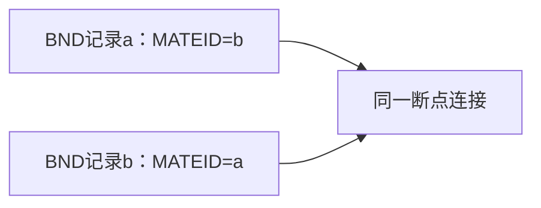

# 复杂重排与BND事件图

> 更新：2026-10-15；状态：可用；验证范围：官方文档与方法核对；专业命令为模板，本轮未执行该流程。

用片段与连接关系描述复杂结构，避免把若干BND行简单当成若干独立变异。

## 图里分别画什么

把参考片段或断点端视为节点，把观测连接视为边；标出染色体、位置、朝向和支持来源。多个连接可能属于同一复杂事件，也可能来自不同单倍型或样本亚群，需要额外证据串联。

DEL、INV、DUP等简化标签可表达某些结构，但多连接复杂重排往往不足以用一个SVTYPE和长度还原。图只是表达方式，不会自动解决相位或事件归属。

## 交付时保留层级

保存原生记录、mate关系、事件分组及作出分组的依据。能明确连接但不能完整恢复结构时，报告已支持的连接和不确定部分；不要把一个最顺眼的示意图当作确定的染色体序列。

事件匹配需考虑连接两端与方向，不能仅比较单端POS。进一步见[断点置信区间与事件方向](https://github.com/SpiralKernel/bioinfo-wiki/wiki/%E6%96%AD%E7%82%B9%E7%BD%AE%E4%BF%A1%E5%8C%BA%E9%97%B4%E4%B8%8E%E4%BA%8B%E4%BB%B6%E6%96%B9%E5%90%91)、[SV事件匹配与一对一评估](https://github.com/SpiralKernel/bioinfo-wiki/wiki/SV%E4%BA%8B%E4%BB%B6%E5%8C%B9%E9%85%8D%E4%B8%8E%E4%B8%80%E5%AF%B9%E4%B8%80%E8%AF%84%E4%BC%B0)；格式定义见[VCF规范](https://samtools.github.io/hts-specs/)。

## 两条记录对应一个连接

这只是mate关系示意；两条记录不等于两个独立事件，多条连接也未必已经恢复完整重排或相位。
