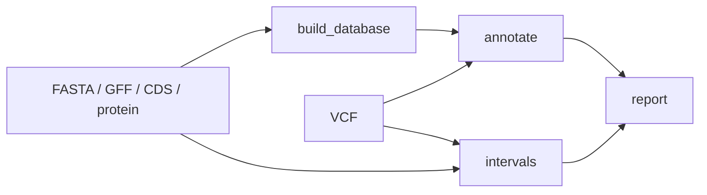

# 最小注释工作流与Snakemake恢复

> 更新：2026-10-14；状态：可用；验证范围：人工基因案例与实际工具输出核对；具体已测范围见正文。

把人工注释案例写成依赖图，并实际检查首次运行、无变化重跑和缺失交付表恢复。

## 环境与首次运行

先完成[人工基因贯通区间注释与后果提取](https://github.com/SpiralKernel/bioinfo-wiki/wiki/%E4%BA%BA%E5%B7%A5%E5%9F%BA%E5%9B%A0%E8%B4%AF%E9%80%9A%E5%8C%BA%E9%97%B4%E6%B3%A8%E9%87%8A%E4%B8%8E%E5%90%8E%E6%9E%9C%E6%8F%90%E5%8F%96)的Java、SnpEff和bedtools准备。另建Python环境安装Snakemake；Linux/macOS或WSL在项目根目录运行：

```bash
python3 -m venv .venv-workflow
.venv-workflow/bin/python -m pip install snakemake==9.27.0
export SNPEFF_JAR="/你的实际绝对路径/snpEff.jar"
.venv-workflow/bin/snakemake   --snakefile examples/workflows/annotation/Snakefile   --configfile examples/workflows/annotation/config.yaml   --directory examples/output/annotation-workflow --cores 1
```

本机Python3.14.8/Snakemake9.27.0已实际运行；其他Python版本需核对该release要求。Python环境不会自动安装Java或bedtools。非PATH工具设置BEDTOOLS_BIN/JAVA_BIN，配置output默认results。

## 依赖与交付



all显式要求summary、注释VCF、后果表和区间交付表。数据库与区间结果可独立复用。输入、代码和工具资源在规则中声明，报告另核对输入及数据库SHA，拒绝混合新旧阶段结果。

## 自动验证恢复

使用一个尚不存在的目录运行验证器，避免删除已有项目结果：

```bash
.venv-workflow/bin/python examples/validate_annotation_workflow.py   --snakemake .venv-workflow/bin/snakemake   --workdir examples/output/workflow-check-new
```

验证器首次运行5个规则（4计算+all），第二次无任务且输出时间戳不变，再仅删除该新目录里的生成表consequences.tsv。第三次只执行annotate、report和all，恢复表SHA相同，数据库和区间结果时间戳不变。已有验证目录会拒绝运行，下次换新目录。

本轮验证目录不同于上方手工运行目录，两者结果独立。公开[validation.json](https://raw.githubusercontent.com/SpiralKernel/bioinfo-wiki/main/assets/annotation-workflow-round1/workflow-validation.json)记录实际结果；源码在[examples/workflows/annotation](https://github.com/SpiralKernel/bioinfo-wiki/tree/main/examples/workflows/annotation)。

## 失败时保留什么

保存Snakemake日志、规则命令、配置和输入校验值。不要因为最终报告存在就认为所有表都在；必须把需要交付的文件列为目标。本例未验证强制中断、集群或云端恢复，工作流系统也不能替代生物学检查。继续读[Snakemake规则配置与断点续跑](https://github.com/SpiralKernel/bioinfo-wiki/wiki/Snakemake%E8%A7%84%E5%88%99%E9%85%8D%E7%BD%AE%E4%B8%8E%E6%96%AD%E7%82%B9%E7%BB%AD%E8%B7%91)。
